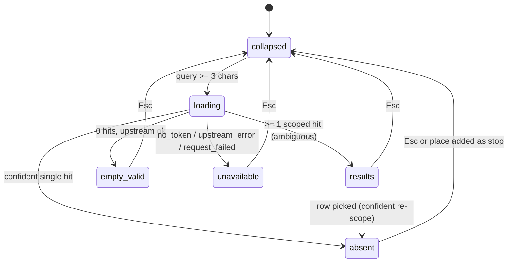

# Admin Route Page — Search State Layout (frame spec)

## Scope and mode

The **route workspace** in `apps/admin` (`pages/RouteWorkspace.tsx`), all four derived states
(empty / overview / focus / edit), with the search surface rebuilt as a **second left column**.
Visitor mode: **Operate**. Desktop only; the workspace floor is unchanged.

This is a _frame spec_: what to draw in Figma and what to build against afterwards. It records
decisions, not implementation — the code and its tests remain the description of how it works.

## The model

A Google-Maps-shaped reveal, in the app's own plate grammar: the stops column is the permanent left
sidebar, and a **320px context column slides out beside it** while a search session is live, then
leaves on `Esc`. The map is a full-bleed backdrop throughout and **never resizes** — the column
overlays it, so SC-002 and ADR-0015 §1's "the GL canvas never resizes at all" both still hold.

Why two columns and not one swapping column: a POI is inserted **after the currently selected stop**
(`addPoiAsStop` → `insertStopBetween`). The stops list is therefore the insertion anchor, and hiding
it during the search would hide the context the decision depends on. Two columns is what keeps the
anchor, the results and the map visible at once.

## Geometry

Design width 1536 → workspace **1488** (48 rail), header 56, workspace height 679. Gutter 0; each
column carries a **12px inset** (`p-3`) so plates read as floating, per ADR-0015 §2.

```
| 256 stops | 320 context (revealable) | minmax(0,1fr) map | 336 properties (edit only) |
```

Refined at implementation (#24): the context column is an **overlay panel** anchored to the free
region's left edge, not a fourth grid track. A track would reflow the transparent centre and shift
the floating chrome — the search pill — sideways the instant results appear, moving the input under
the caret. The grid therefore keeps its five tracks (`256 | 0 | centre | 0 | 336`), the plate paints
above the map and below the stops column, and `deriveWorkspaceLayout` reports the 320 px as an inset
(so the free region is 912 px during a session) without changing the template.

| State             | Tracks present      | Unoccluded map @1488       |
| ----------------- | ------------------- | -------------------------- |
| empty             | map only            | 1488                       |
| overview          | 256 + map           | 1232                       |
| focus             | 256 + map + 336     | 896                        |
| edit              | 256 + map + 336     | 896                        |
| **edit + search** | 256 + **320** + map | **912** (Properties hides) |

Tokens become `WORKSPACE_GEOMETRY = { leftCol: 256, contextCol: 320, rightCol: 336, gutter: 0,
minMapWidth: 400 }`. `computeMapWidth` keeps its name and the 400px floor, but now measures the
**unoccluded** width rather than a canvas width — the canvas is always the full workspace.

Narrow windows: at the 1024 window ADR-0015 documents (976 workspace) the search state lands on
`976 − 576 = 400`, exactly the floor, so `NarrowWindowGate` opens just as it does today; edit stays
at 384 and still gates. No gate rule changes.

## The context column

- **Width** 320. Content-adaptive height, capped at **66%** of the workspace (`max-h-[66%]`), header
  pinned, rows scrolling inside the plate. The stops list keeps its own window above the plate's
  bottom edge; the two scrollbars never form one continuous bar.
- **Reveal** is a transform, not a layout change: `translateX` from behind the stops column,
  **180ms ease-out**, reversed on `Esc` with the same curve. Instant when
  `prefers-reduced-motion: reduce`. The plate stays **mounted** while collapsed so reopening is
  free; `searchActive` stays the only trigger.
- **Trigger is the first query, not focus.** The plate opens when the debounce fires on ≥3
  characters — i.e. when there is something to show. Focusing the pill alone opens nothing and moves
  nothing.
- **The pill stays in the chrome row** (`top-3 left-3`) and never animates while focused; the plate
  reveals beneath it. `mod+k` focuses the pill (registered with the existing `mod+s`/`mod+z` set;
  never while a dialog is open). `/` is deliberately unused — the map canvas owns bare keys.
- **Properties hides** for the duration of a session and returns on close. Search results and
  Properties never coexist.

## Plate content

**Header — two lines, no repeated query** (the pill is directly above it):

1. `Search results · 3` — Baloo 2 SemiBold 14/20, `#131f25`.
2. Anchor line — Geist Regular 12/16, `#4a585e`:
   `Inserting after #3 · Plaza Libertad`, or `Appends to end — nothing selected`.
   This is the fact that changes the outcome of a click; it makes the insertion rule visible instead
   of implicit.

A hairline `#d8dfe3` rule separates the header from the list (8px above, 8px below).

**Row** — one `<button>` per hit, `width: 100%` (the current frame's 286.4px rows overflow a 280px
plate; 320 + 12px inset fixes it structurally), `padding 6px 8px`, radius 2.4px:

| Line | Type                  | Colour    | Content               |
| ---- | --------------------- | --------- | --------------------- |
| 1    | Geist Medium 14/20    | `#131f25` | place name            |
| 2    | Geist Regular 12/16   | `#4a585e` | formatted address     |
| 3    | Geist Regular 11/16.5 | `#4a585e` | `category · distance` |

**Distance is anchor-relative when an anchor exists**: `sports club · 1.2 km from #3`, falling back to
`· 2.3 km from centre` when nothing is selected. `GeocodeHit.distanceMeters` is camera-relative by
definition (`packages/shared/src/types/mapbox.ts:34`), so the anchor case is computed client-side with
`poiScope.distanceMeters`; the wire value stays the fallback.

**No numbers on candidates.** Stops already own `1..N` as route order and map legend; a numbered
candidate dot beside a numbered stop plate is the worst ambiguity available in this viewport.
Row↔pin binding stays **hover/focus sync** (already two-way) plus the picked state.

**Row states** — rest; hover (plate-grey fill); keyboard focus (2px outline, offset 2); **picked**
(name and 1px border in pick-red `#DC2626`, matching the map marker). Red is never the only signal:
the picked row also carries a filled leading dot.

## Five states of the plate

| State           | Trigger                                            | Content                                                              |
| --------------- | -------------------------------------------------- | -------------------------------------------------------------------- |
| loading         | query fired, request in flight                     | 3 skeleton rows (no pill spinner)                                    |
| results         | ≥1 scoped hit                                      | header + rows                                                        |
| empty but valid | 0 hits, upstream answered (`out_of_area`)          | `Nothing in this area. Move the map and search again.`               |
| unavailable     | `no_token` / `upstream_error` / `request_failed`   | one line naming the cause; no retry button (typing retries)          |
| **absent**      | confident single hit (`poiConfidence.isConfident`) | **no plate** — the dock collapses; map marker + popup are the answer |



`Esc` closes the session (dock collapses, properties return). Clearing the query with `×` ends the
session too, and keeps focus in the pill.

## Camera and measure

One **visible-region** abstraction — the viewport minus the opaque plates of the current state —
drives both:

1. `map.setPadding` so every camera move centres inside the unoccluded area. Today's hand-tuned
   numbers in `RouteFitter` (80), `PoiFocuser` (64 / maxZoom 16) and `fitToOverview` (90 / 14.5) all
   read from it instead. Per state: edit `{left: 268, right: 348}`, search
   `{left: 588, right: 12}`, overview `{left: 268, right: 12}`, empty `{left: 12, right: 12}`.
2. `poiScope`'s in-view test, so search answers with places the admin can actually see.

The reveal pans to keep the route centred in the unoccluded area, expressed as **one**
`easeTo({ padding, duration: 180 })` on the plate's own easing — not a second animation — and is
symmetric on close.

## Accessibility

- Rows form a real list of buttons; `↑`/`↓` walk them (existing panel behaviour), `Enter` picks,
  `Esc` closes.
- The result count is announced (`aria-live="polite"`), so a keyboard user learns the answer size
  without seeing the plate.
- The pill's tooltip shows `⌘K`; the picked state is never colour-only.
- Tab order follows visual order: stops → context plate rows → map chrome (pill, status, actions).

## Out of scope

- Search outside edit state. Opening it globally needs a defined meaning for "pick a place" with no
  draft (fly-to? open a route?), i.e. a second half of the state machine. The dock stays a
  stop-placement tool.
- The previous frame's `250 | 1fr | 250` grid, its 280px plate, the empty right column, the query
  repeated in the plate header, and the `drop-shadow` on _Search this area_ (brand: no shadows).
- Numbered candidate pins.

## Open items (need a decision before code)

1. **Plate radius**: this spec says ≤4px (DESIGN.md), the frame draws 8px, and `components/shared/Plate.tsx`
   ships `rounded-lg` (8px). Either `Plate` moves to `rounded-sm`/4px (and the whole admin changes
   once) or DESIGN.md records an exception for admin plates. Pick one.
2. **Hover preview camera**: today hovering a result row flies the map to that place at zoom 15 after
   90ms (`search/SearchResultsPanel.tsx:56-64`), which now fights the anchor-relative distance and the
   reveal pan. Proposal: hover highlights the pin only; the camera moves on click. Confirming this
   changes existing behaviour.
3. **`searchActive` trigger change**: it is currently set on focus (`PoiSearchBar.tsx:243`). This spec
   moves the plate to a _query_ trigger. Confirm nothing else wants the focus-triggered meaning
   (`poiDismissalFor` uses it to decide what a map click may clear).

## Follow-on work

1. New ADR superseding ADR-0015 §1 (never-resize claim) and §2 (pinned `256 | 336` tracks), keeping the
   four-state model, the token concept, the 400px floor and the gate.
2. GitHub issue carrying geometry, reveal model, five states and the visible-region rule.
3. Code: tokens → `WorkspaceColumns` context track → overlay reveal → visible-region padding/scope →
   plate header/anchor/distance → tests for `computeMapWidth`, the two-slot plate rule and the
   anchor-relative distance formatter.
