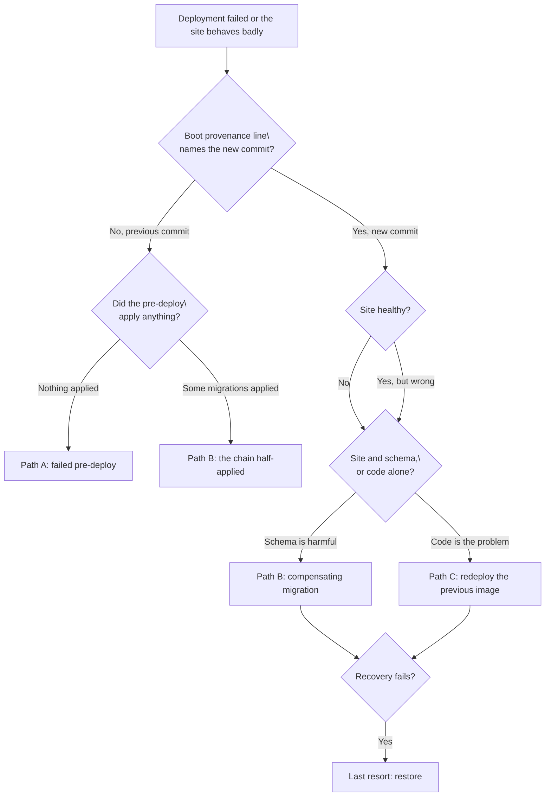

# ROLLBACK — recovering a bad deploy or a bad migration

This is the runbook for the two ways a deployment here goes wrong: the migration step refuses or
fails, and the migration step succeeds at something harmful. It is the operating companion to
`docs/DEPLOY.md` §3.4, where the pre-deploy step is described, and to
`docs/adr/0022-railway-platform-utilization.md` §3 (which primitive carries the step) and §7.3 (the
provenance line this runbook reads). The topology beneath it is `docs/adr/0018-deployment-topology.md`
§5 — migrations are an explicit step before the new container goes live, never container boot.

**Status: the runbook is written and both drills were executed on staging on 2026-11-10.** The
[exercise log](#exercise-log) is the record of what was observed; the [drills](#drills) section is the
procedure that was followed. `docs/ROADMAP.md` M4's exit criterion is met by that record.

## Rule zero: establish what is actually running

Everything below branches on two facts, and both are cheap to get wrong by assuming.

**Which commit the container is serving.** The server logs a provenance line once at boot, before
`listen` — which is the load-bearing part, because the deploy whose revision matters most is the one
that never becomes healthy:

```bash
railway logs -d --lines 500 | grep "deployment provenance"
```

A healthy answer names `commitSha`, `branch`, `environment` and `deploymentId`. If the line is absent,
you are either not reading deployment logs (`-d`) or the container never got as far as boot.

**Which revision the platform thinks is current, and what preceded it.** `railway logs` answers what
is running; this answers what else could be:

```bash
railway deployment list -s komyuter -e staging --json --limit 20
```

Read the statuses, not just the newest row: a `FAILED` deployment with a `SUCCESS` one behind it is
the shape of a failed pre-deploy, and the successful one is the image still serving.

**What the schema thinks it is.** The migration history is the third record, and it is the one that
disagrees silently when a chain half-applied:

```bash
railway run -s komyuter -e staging -- sh -c 'supabase migration list --db-url "$DATABASE_URL"'
```

(`railway run` injects the service's variables into the child, so the URL expands inside the child's
shell, not this one. Do not run `railway variables list` to read it: the CLI's own help warns that
`list`, `--json` and `--kv` print raw secret values.)

Cross-check that history against the image: the migrations the running container carries are the ones
at `supabase/migrations/` in the commit rule zero named. **A history row with no local file means
someone applied SQL that is not in source — that is the state that makes a later `db push`
unpredictable, and `supabase db push --include-all` will happily apply around it rather than refuse.**

## Triage



The first question is the one that decides whether anything was written. If the provenance line still
names the **previous** commit, no new container is serving — but that does **not** mean no new SQL ran,
because the pre-deploy step runs before the container does. Answer "did it apply anything" from the
migration history, never from the fact that the deploy failed.

## Path A — the pre-deploy failed

The intended property, and ADR-0022 §3.1's whole point: a failing pre-deploy **fails the deployment**
instead of shipping a new container against an old schema. Measured during M1 provisioning on this
project — four failed deployments left the URL answering throughout (`docs/DEPLOY.md` §3.4) — but not
yet measured for the pre-deploy step specifically. That is Drill 1.

**A1 — the runner refused, before the CLI ran.** The log reads `pre-deploy: missing required
environment variable(s)`, or a mismatch between `RAILWAY_ENVIRONMENT_NAME` and `EXPECTED_ENVIRONMENT`,
or a project-ref disagreement between `DATABASE_URL` and `EXPECTED_SUPABASE_PROJECT_REF`. Nothing has
been applied and nothing needs undoing: the guard exists precisely so a misdirected `DATABASE_URL`
cannot migrate the wrong project. Fix the variable, redeploy.

**A2 — `supabase migration list` failed.** Unreachable target or bad credentials. Nothing applied.
Correct the connection and redeploy.

**A3 — `supabase db push` failed.** This is the one that is not "nothing applied". The push may have
applied the migrations before the failing one, so the previous container may now be serving against a
schema that is **ahead of it**. Confirm from the history which versions landed, then choose:

- **Fix forward**, when the failing migration is wrong and the applied prefix is compatible with the
  running image: correct the file (it was never applied, so editing it is allowed), push, deploy.
- **Path B**, when the applied prefix is not compatible with the running image: write a compensating
  migration for what landed and treat it as Path B from there.

Then, whichever of A1–A3 it was:

1. **The previous deployment is still serving.** Leave it there while you work — that is the state to
   preserve, not to escape.
2. **Fix forward** by pushing a correction to the environment's branch (`dev` → staging, `main` →
   production), or **redeploy the previous image** if you would rather return to a known state first
   (Path C). Production adds the approval gate: a `main` merge builds and waits, so a failed
   production pre-deploy costs nothing but a failed deployment record.
3. **Verify** with the checklist below before declaring it recovered. A deploy that reports `SUCCESS`
   is not the same as a service that can write.

**The drill's whole point** is that this path leaves the site up. If a failed pre-deploy ever takes
the URL down, that is a defect in the pipeline, not an accepted cost.

## Path B — a migration applied and is harmful

The rule that governs everything else here: **never edit a migration that has been applied.**

Editing it does not change the database, and it destroys the only faithful record of what ran. A fresh
environment (a new Supabase project, a local reset) would then replay different SQL than production
did, so the two silently diverge — and the divergence is invisible until something breaks in a way
that only one of them can reproduce. The history table remembers a version, not a file.

1. **Write a new compensating migration**, next version number, that undoes the harm while keeping the
   data. It is additive by construction: drop the constraint, restore the column, recreate the index,
   reverse the `UPDATE` — whatever the harmful migration did, expressed as a forward step.
2. **Apply it through a new deployment** (push to the environment's branch) where time allows, because
   that is the path with the guard, the record and the approval gate. Where the harm is active and
   waiting is worse, apply it directly — the same command the pre-deploy runs:

   ```bash
   supabase db push --db-url "<this environment's DATABASE_URL>"
   ```

   A local URL needs `?sslmode=disable`; a Cloud URL needs TLS (`docs/DEPLOY.md`, local rehearsal).
   Use the session pooler, never the transaction pooler: the step holds an advisory lock and runs
   multi-statement DDL, neither of which survives transaction-mode pooling.

3. **Redeploy the previous image** if the new code is what is incompatible — see Path C. A
   compensating migration makes the schema safe for the old code; it does not put the old code back.
4. **Verify** with the checklist below. For this path, the counts check is not a formality: it is the
   only observation that distinguishes "the harm is undone" from "the harmful migration also dropped
   rows".

**`supabase migration repair` is not a rollback and must not be used as one.** It rewrites the
`supabase_migrations.schema_migrations` rows and touches no schema: `--status reverted` on a version
whose effect is still in place makes the chain lie, and the next `db push` will try to apply it again.
It is legitimate for exactly one thing here — reconciling the record after a drill file has been
removed from source (Drill 2's cleanup).

## The expand/contract rule — mandatory, not stylistic

Every migration must be readable by the **image that is currently serving**, because the pre-deploy
step can move the schema while that image is still the one answering requests. Two facts make this
binding rather than advisory:

- **The pre-deploy step may run before production approval** (ADR-0022 verification gap 1, still
  unmeasured). If it does, an unapproved production deployment has already migrated, so the schema is
  ahead of the code by however long the approval waits.
- **A failed deployment does not undo an applied migration.** The previous container is serving until
  something replaces it, and it is serving against whatever schema the failed attempt left.

So a change to a column or table that the running image touches is never one migration. It is four
phases across at least two deployments:

| Phase        | What lands                                                    | Safe because                                  |
| ------------ | ------------------------------------------------------------- | --------------------------------------------- |
| **Expand**   | New nullable column, new table, new index, widened constraint | The old image neither reads nor writes it.    |
| **Backfill** | Data written into the new shape by new code                   | Old and new images can both run against it.   |
| **Enforce**  | `NOT NULL`, a validated constraint, the new index required    | Verified only after the backfill is complete. |
| **Contract** | Drop the old column, table or permissive constraint           | The old image is gone from every environment. |

Two consequences worth stating because they are where this goes wrong in practice:

- **The old column is dropped in a later release than the one that stopped using it.** Dropping it in
  the same release leaves a window — approval latency in production, a failed container that never
  replaced the previous one — in which the serving image still selects a column that no longer exists.
- **A constraint added with `NOT VALID` is enforceable against new rows immediately and existing rows
  only after `VALIDATE CONSTRAINT`.** That is the tool for enforce-after-backfill, and it is also the
  reason Drill 2's `CHECK (false) NOT VALID` breaks the write path without touching a single row.

When in doubt, split. A migration that must be finished forward is the expensive case this rule
exists to avoid.

## Path C — the code is the problem, not the schema

The cluster of commands here is smaller than it looks, and `railway rollback` is not one of them — the
CLI at 5.64.0 has no such subcommand.

| Goal                                         | How                                                                         |
| -------------------------------------------- | --------------------------------------------------------------------------- |
| Redeploy the **latest** deployment unchanged | `railway redeploy -s komyuter -e staging` (the CLI offers no target id)     |
| Return to a **specific earlier** deployment  | the dashboard's deployment list, or `railway down` to remove the newest one |
| Return the **source** to an earlier revision | `git revert` on the branch, push, let the pipeline build it                 |

`railway redeploy` is the wrong tool for a rollback: it redeploys the latest, which is the bad one.
`railway down -s komyuter -e staging` removes the most recent deployment and leaves the previous one
active — the CLI's own description is "Remove the most recent deployment" — but it deletes a record
you may still want, so prefer the dashboard when you are not certain the previous deployment is the
one you want serving.

**Reverting the source and reverting the image are not the same operation.** A `git revert` builds a
new image from the reverted tree, and the pre-deploy step then runs again — against a schema the
harmful release already changed. That is exactly the case the expand/contract rule exists for: a
revert is only clean if the schema moved additively. Where it did not, a compensating migration
(Path B) comes first, and the revert follows it.

## Last resort — restore the database

**Measured on this project's Supabase organization (2026-11-08): the plan is `free` (`tier_free`).**
That single fact changes this section from what the phrase "restore from backup" implies, because
neither in-platform backup mechanism exists on a free-tier project:

- **No automated backups.** Supabase takes daily backups for Pro, Team and Enterprise projects only;
  free-tier projects have none. Its own advice is to export with `supabase db dump` and keep copies
  off-site — which, on this plan, is not a recommendation but the only backup that exists.
- **No point-in-time recovery.** PITR is a Pro/Team/Enterprise add-on with a paid retention window
  (2-minute RPO, restore to any point in it), and it replaces daily backups rather than adding to them.

So on the current plan the last resort is **the most recent logical dump someone took before the
change**, and the data-loss window is _everything written since that dump_ — every route, direction
and stop the team plotted in between, with no way to reconstruct it. That asymmetry is the reason the
step below is a precondition rather than a suggestion:

> **Before any migration that can lose or rewrite data, take a dump and move it off the machine.**

```bash
supabase db dump --db-url "<DATABASE_URL>" -f "backup-$(date +%F-%H%M).sql"
```

The dataset export (`GET /api/admin/export/dataset`) is a second, narrower recovery artifact: it
covers the dataset itself, not accounts or auth identities, and ADR-0027 already notes it doubles as
one. It is not a substitute for a dump.

**If the plan changes to Pro, the restore path becomes available and is still the last resort.** A
restore replaces the project's entire state with an earlier snapshot and takes the project offline for
the duration; it is not a targeted undo, and it discards everything after the restore point. Restore
to a new project first if the current data might still be wanted. A free-tier project can be cloned
into a paid one the same way.

Either way, a restore is a **schema and data** operation: the deployed image is untouched, so after a
restore confirm that the image and the restored schema still agree, and redeploy the image that
matches (`docs/DEPLOY.md` §3.6's provenance line is how you know which).

## Verification checklist

Run all of it before calling any of the paths above "recovered". Checks 1–3 can pass while the service
is unable to write, which is why 4 and 5 exist; 6–8 prove the security posture survived the change.
The payloads and their order are in `docs/DEPLOY.md`'s local rehearsal, checks 1–9 — follow those
rather than reconstructing them.

| #   | Check                 | Observable pass                                                                                         |
| --- | --------------------- | ------------------------------------------------------------------------------------------------------- |
| 1   | Postgres reachability | `GET /api/status` returns the dataset counts, not 500                                                   |
| 2   | Sign-in               | `POST /api/auth/login` returns 200 with an `access_token`, accepted by `/api/auth/me`                   |
| 3   | Route read            | `GET /api/admin/routes` with that token returns the expected routes                                     |
| 4   | Write path            | Create a route, a direction with a `LineString`, two ordered stops; geometry survives; delete the route |
| 5   | Counts                | `/api/status` matches the pre-incident baseline, not merely "plausible"                                 |
| 6   | CSP                   | `connect-src 'self' https://tiles.openfreemap.org;` and **no** API origin                               |
| 7   | Foreign `Origin`      | A non-allow-listed `Origin` is refused `403`                                                            |
| 8   | Dev credential        | `ALLOW_DEV_CREDENTIAL=false` refuses the documented dev credential `401`                                |
| 9   | Provenance            | The boot line names the commit you intend to be serving                                                 |

Counts move in specific ways while exercising check 4 — one direction brings its auto-derived return
direction and its own stops, deleting a stop that is still a direction terminal is `409`, and a fare
config's delete is a soft delete. `docs/DEPLOY.md`'s check 9 states them; read it before recording a
mismatch as damage.

## Exercise log

Both drills were run on 2026-11-10. Each row carries the artifact that makes it a record rather than a
claim: a deployment id, a log excerpt, the API responses that bracket the change.

| Date       | Environment | Failure mode                  | Drill file(s)                     | Observed                                                                                                                                                                                                 | Evidence                                                               | Restored |
| ---------- | ----------- | ----------------------------- | --------------------------------- | -------------------------------------------------------------------------------------------------------------------------------------------------------------------------------------------------------- | ---------------------------------------------------------------------- | -------- |
| 2026-11-10 | staging     | Failed pre-deploy (Drill 1)   | `9999_drill_broken_migration.sql` | Deployment `c9c74522` **FAILED**; `supabase db push` → `SQLSTATE 42601`; `9999` stayed local-only in the history; `0181ad21` (`3114144`) kept serving; counts unchanged                                  | deployment ids, pre-deploy log excerpt, `/api/status` before/after     | n/a      |
| 2026-11-10 | staging     | Applied-but-harmful (Drill 2) | `9998_…`, compensating `9999_…`   | `9998` applied by `411f2140` (SUCCESS); probe create → `500` (`violates check constraint "m4_drill_no_insert"`); `9999` applied by `d14ef19e` (SUCCESS); probe create → `201`; counts 6/12/194 unchanged | deployment ids, both API responses, server log excerpts, `/api/status` | yes      |

## Drills (executed 2026-11-10 on staging)

Both travelled through **staging only**, as pull requests merged to `dev` — which is PR-only now
(required `check` and `iac-drift`, enforced for admins too), and is what staging tracks. Neither drill
file reached `main`. A drill migration on `main` would be a production deployment that either fails the
pre-deploy (Path A, noisy) or applies a deliberate constraint to production data (Path B, unacceptable).
Check `git log --all --oneline -- supabase/migrations/` before any promotion, and again at release time.

**One coupling was found by running this.** The drill versions `9998`/`9999` collided with fixtures in
`deploy/check-data-plane.test.mjs`, which pinned those numbers as "a remote version with no local file".
A transient drill file then made the fixture exist locally, inverted two parity cases, and failed CI on
the first drill PR. The fixture now derives the version from the files actually present
(`ABSENT_VERSION`), so a drill migration cannot break that suite again.

The migrations directory is in `build.watchPatterns`, so a drill file alone triggers the rebuild and
deploy the drill needs.

### Drill 1 — a failing migration blocks the deploy and nothing is applied

**Pass/fail.** Passes only when all four are observed: the deployment ends `FAILED`; the previous
container is still serving; the drill migration is absent from the remote history; and the site never
stops answering. Any of them missing is a finding, not a variation.

1. Add `supabase/migrations/9999_drill_broken_migration.sql` containing SQL that is unambiguously
   invalid — a deliberate syntax error is the point, because the drill is about the pipeline, not about
   a plausible bug.
2. Commit and push to `dev`. Staging rebuilds and the pre-deploy step runs.
3. Observe, in order:
   - `railway deployment list -s komyuter -e staging --json` shows the newest deployment `FAILED` and
     the one behind it `SUCCESS`.
   - `railway logs -d --lines 500 | grep "deployment provenance"` still names the **previous** commit —
     the failed one never booted.
   - `/api/status` still returns counts, and a sign-in still succeeds: the previous deployment kept
     serving.
   - The failed deployment's log carries the runner's own `supabase migration list` table, with
     `9999` in the local column and empty in the remote one. That table is the primary evidence, and
     `railway run … supabase migration list --db-url "$DATABASE_URL"` is the independent confirmation.
4. **Clean up.** Delete the file, commit, push, and confirm the next deployment succeeds and reports
   `Remote database is up to date.` Then confirm the drill version never entered the remote history —
   if it did, that is a finding: the pre-deploy would have applied it. Nothing else needs undoing,
   which is the property being proven.

### Drill 2 — a harmful-but-reversible migration is undone by a compensating one

This drill exercises Path B by breaking the **write path** while deleting nothing, so the recovery is
a genuine compensating migration and no data is at risk.

**Pass/fail.** Passes only when: the write path fails after the drill migration; the site stays
readable throughout (check 1 and 3 of the checklist still pass); the compensating migration restores
the write path; counts are unchanged across the whole exercise. A count that moved is a failed drill,
not a rounding error.

1. Add `supabase/migrations/9998_drill_break_writes.sql`:

   ```sql
   ALTER TABLE routes ADD CONSTRAINT m4_drill_no_insert CHECK (false) NOT VALID;
   ```

   `NOT VALID` is what makes this harmless and instructive at once: existing rows are never scanned,
   so nothing is deleted and reads keep working, while every insert and update to `routes` is now
   refused. That is the write path, and only the write path.

2. Commit, push to `dev`, let the deployment finish. It will succeed — a pre-deploy only fails when the
   CLI fails, and this SQL is valid.
3. **Observe the break.** The verification checklist separates cleanly: 1–3 pass (status, sign-in,
   route read) and 4 fails (`23514`, a check-constraint violation on insert, rather than a 500 that
   could mean anything). Record the before/after counts in the exercise log here — this is the evidence
   that the drill broke writes without moving data.
4. Add `supabase/migrations/9999_drill_recover_writes.sql`:

   ```sql
   ALTER TABLE routes DROP CONSTRAINT m4_drill_no_insert;
   ```

   Commit, push, and let the next deployment apply it through the pre-deploy step. Writing the repair
   as a **new** migration rather than reverting the drill file is the point of the drill: it is the
   same move Path B prescribes.

5. **Confirm recovery.** The full checklist passes, including the write path round trip, and
   `/api/status` counts are identical to step 3's before-count.
6. **Clean up, in this order.** Delete **both** drill files, commit and push. Then reconcile the remote
   history, because two versions were applied whose files no longer exist: mark them reverted
   (`supabase migration repair --status reverted 9998`, then `9999`) and confirm
   `supabase migration list --db-url "$DATABASE_URL"` reports local and remote in agreement with no
   drill rows. `repair` edits only the history table — it does not touch the schema, and it is
   legitimate here **because** the compensating migration already dropped the constraint, so the record
   it writes is truthful. Then confirm the next deployment applies nothing and the write path still
   passes.

**Measured on 2026-11-10: the repair is required, not optional.** The deployment carrying only the two
deletions failed at `supabase db push` with `Remote migration versions not found in local migrations
directory`, and the CLI printed the repair command itself. The previous container kept serving
throughout, and the same commit deployed green after the repair, reporting `Remote database is up to
date.` So `repair` stays in this procedure.

A machine that cannot reach `db.<ref>` (IPv6-only, with port 5432 blocked) runs the repair through the
IPv4 **session pooler** instead — `postgresql://postgres.<ref>:<password>@aws-0-<region>.pooler
.supabase.com:5432/postgres` — because `railway run` executes locally and inherits the same network.

## What this runbook deliberately does not do

- **It does not automate any of it.** A rollback button would have to decide between three paths on
  evidence the platform does not hold; the operator reads the provenance line and the history instead.
- **It does not restate the deploy procedure.** `docs/DEPLOY.md` owns environment setup, the variables,
  the auth policy and the write-path payloads. This file assumes all of that is in place and asks only
  what to do when it is not.
- **It does not cover a Supabase or Railway outage.** Those are incidents, not rollbacks: the remedy is
  to wait, and ADR-0018 already records that the app depends on both vendors.
